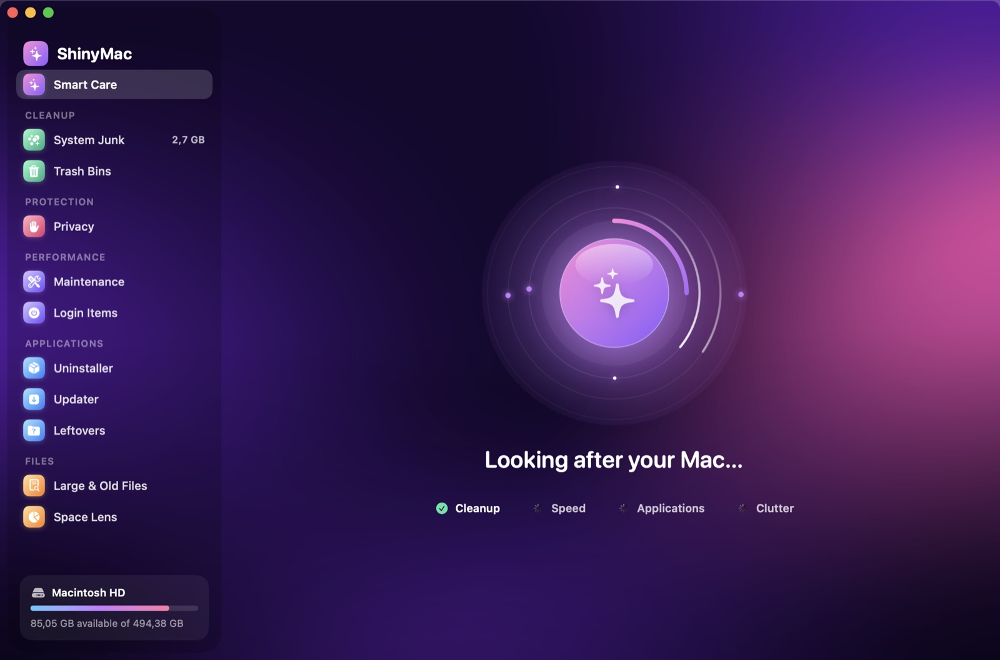
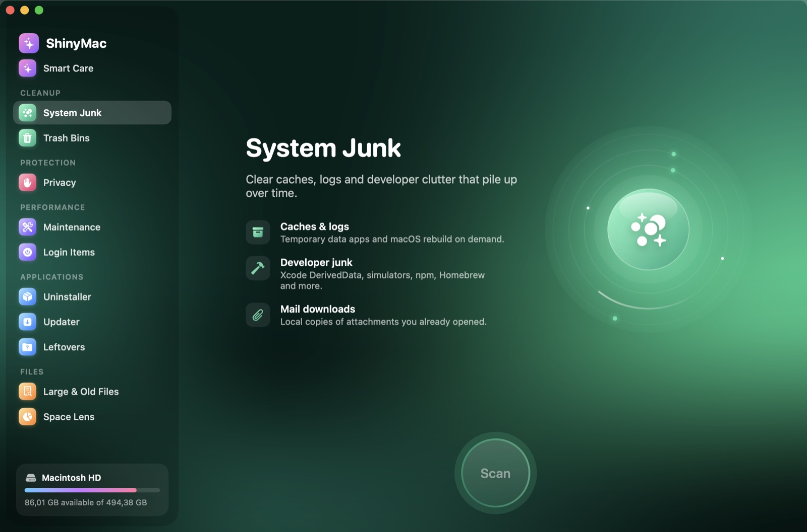
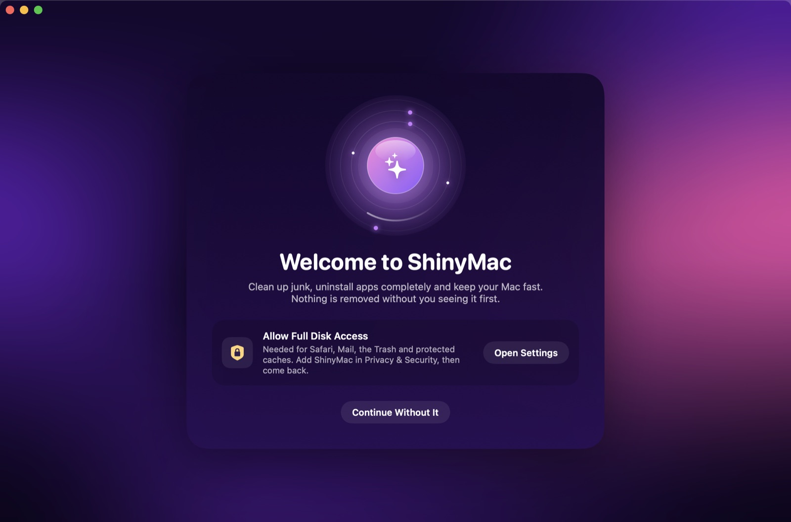

<p align="center">
  
</p>

<h1 align="center">ShinyMac</h1>

<p align="center">
  A free, open-source Mac cleaner with a gorgeous native UI.<br>
  Clean junk, uninstall apps completely, and keep your Mac fast.
</p>

<p align="center">
  <a href="https://github.com/pballada/shinyMac/actions/workflows/ci.yml"></a>
  
  
  <a href="LICENSE"></a>
</p>

<p align="center">
  
</p>

## Features

Everything you need to keep a Mac clean and fast, in one native SwiftUI app with animated aurora backgrounds and Liquid Glass.

| | Module | What it does |
|---|---|---|
| ✨ | **Smart Care** | One scan across every module, a dashboard of what it found, and a one-click tune-up |
| 🫧 | **System Junk** | User caches, logs, Xcode DerivedData and simulators, Homebrew/npm/pip/Yarn/CocoaPods/SwiftPM/Gradle/Cargo caches, Mail downloads, Photos analysis caches, old iPhoto/Aperture libraries, broken preferences, iOS firmware and old device backups, stale downloads |
| ☁️ | **Cloud Cleanup** | Frees space taken by downloaded iCloud Drive, Dropbox, Google Drive, OneDrive and Box files. The files stay in the cloud |
| 🗑️ | **Trash Bins** | Every Trash, including external drives, with a Finder fallback when access is restricted |
| ✋ | **Privacy** | History and cookies for Safari, Chrome, Edge, Brave, Arc, Vivaldi, Opera and Firefox, plus Recent Items. Never touches passwords or bookmarks |
| 🔐 | **App Permissions** | Which apps can use the camera, microphone, screen recording, Accessibility, Input Monitoring, Full Disk Access and more, including permissions left by deleted apps |
| 🔧 | **Maintenance** | Free up RAM, flush DNS, reindex Spotlight, rebuild Launch Services, reset Quick Look and font caches, thin Time Machine snapshots, speed up Mail, clean up Homebrew, all behind a single password prompt |
| ⏻ | **Login Items** | Every launch agent and daemon, which app owns it, whether it's running, and **broken** items left by deleted apps |
| 📦 | **Uninstaller** | Apps plus every file they scatter across 22 Library locations; *Reset* wipes an app's data but keeps the app. Filters for unused, large and Intel-only apps. Drop an app on the window or Dock icon to start |
| ⬇️ | **Updater** | Checks Sparkle feeds and the App Store for newer versions |
| ❓ | **Leftovers** | Support files from apps you already deleted, matched conservatively |
| 🧩 | **Extensions** | Quick Look and Spotlight plug-ins, preference panes, screen savers, internet plug-ins |
| 📄 | **Large & Old Files** | Big and forgotten files by kind, age and size, scanned on all cores |
| 👯 | **Duplicates** | Byte-for-byte identical files (SHA-256 verified); keeps the oldest copy |
| 🥧 | **Space Lens** | Interactive sunburst map of any folder: hover, drill down, remove |
| 🔥 | **Shredder** | Drop files to delete them immediately, skipping the Trash |
| 📈 | **Menu bar monitor** | CPU, memory, disk, battery and network at a glance, the top apps by CPU or memory, and one-click RAM cleanup |
| 🛠️ | **Xcode** | Simulator runtimes, simulators, DerivedData per project, device support, archives, previews and extra Xcode copies, with safe defaults |
| 🔔 | **Notifications** | A gentle note when free space runs low or the Trash gets big, plus weekly Smart Care reminders |

<p align="center">
  
  
</p>

## Safety first

- **You see everything before it goes.** Every module lets you review exactly what will be removed.
- **Recoverable by default.** Apps, leftovers and large files go to the Trash. Only regenerable data (caches, logs) is deleted outright, and *Settings › Move everything to the Trash* changes that too.
- **A hard safety net.** `SafetyGuard` refuses to touch system folders, top-level home folders or anything too shallow, no matter what a scanner proposes.
- **Conservative matching.** Leftover detection uses bundle-ID component boundaries and exact names, skips Apple, and ignores anything belonging to a vendor whose apps you still have.
- **Opt-in for risky items.** Cookies, installer packages, Xcode archives and possible user data start unchecked.

## Install

### Homebrew

```sh
brew install --cask pballada/tap/shinymac
```

### Download

Every commit on `main` is built by CI. Grab `ShinyMac.zip` from the latest [CI run](https://github.com/pballada/shinyMac/actions/workflows/ci.yml) or from [Releases](https://github.com/pballada/shinyMac/releases).

The app is ad-hoc signed, not notarized. The first time, right-click it and choose **Open**.

### Build from source

Requires Xcode 26 or later.

```sh
git clone https://github.com/pballada/shinyMac.git
cd shinyMac
make run      # builds build/ShinyMac.app and opens it
make test     # runs the ShinyCore test suite
```

### Releasing

`./scripts/release.sh 0.2.0` builds a universal binary, signs it with your Developer ID (hardened runtime), notarizes and staples it, and prints the zip's SHA-256 for the Homebrew cask. One-time setup is described at the top of the script.

### Full Disk Access

macOS hides Safari data, Mail downloads, the Trash and some caches from apps. For a complete scan, add ShinyMac under **System Settings › Privacy & Security › Full Disk Access**; the welcome screen links straight there. Everything else works without it.

## Architecture

```
Sources/
  ShinyCore/   Scanning, sizing and cleaning engine. Foundation only, Swift 6, fully tested.
  ShinyMac/    SwiftUI app (main-actor by default): design system, modules, menu bar monitor.
Tests/
  ShinyCoreTests/   Swift Testing suite, run against fake home folders.
```

- **Engine and UI are separate.** Every scanner is a plain function in `ShinyCore`, tested against throwaway home folders. The app runs them off the main actor and polls a lock-free `ScanProgress`.
- **One flow, many modules.** `CleanupModel` drives scan → results → review → clean → done for System Junk, Trash, Privacy and Leftovers.
- **Design system.** Per-section themes, a drifting `MeshGradient` aurora, Liquid Glass (macOS 26) with a material fallback, an orb action button and layered hero illustrations.

## License

[MIT](LICENSE)
